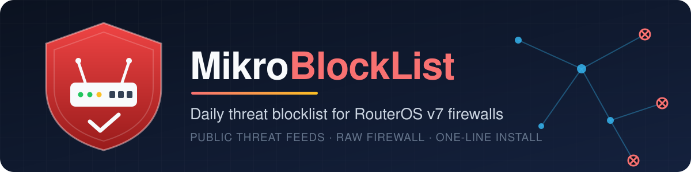
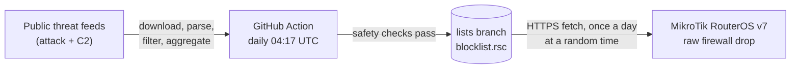

<p align="center">
  
</p>

<p align="center">
  <b>A daily, auto-built IPv4 blocklist of attackers and botnet C2 servers, dropped in the raw firewall of your MikroTik router.</b>
</p>

<p align="center">
  <a href="https://github.com/Psycomy/MikrotikBlockList/actions/workflows/build.yml"></a>
  <a href="https://github.com/Psycomy/MikrotikBlockList/tree/lists"></a>
  <a href="https://github.com/Psycomy/MikrotikBlockList/tree/lists"></a>
  <a href="LICENSE"></a>
  
</p>

<p align="center">
  <a href="#install">Install</a> ·
  <a href="#what-gets-created">What gets created</a> ·
  <a href="#see-what-is-blocked">Logs</a> ·
  <a href="#allowlist">Allowlist</a> ·
  <a href="#uninstall">Uninstall</a> ·
  <a href="#sources-and-licenses">Sources</a> ·
  <a href="#-español">Español</a>
</p>

> [!WARNING]
> **For home / non-commercial use only — several sources forbid commercial use.**
> Some feeds are CC BY-NC-SA or "non-commercial only", and others have no explicit
> redistribution license (see [Sources and licenses](#sources-and-licenses)).
> If you need a blocklist for a business, get the feeds under a commercial license yourself.

## How it works



1. Every day a GitHub Action downloads the [sources](#sources-and-licenses), drops private,
   reserved, CGNAT and other non-global ranges (and anything broader than a /8), subtracts the networks in the
   repository [`allowlist.txt`](allowlist.txt) (GitHub's download range, the big public DNS
   resolvers and Cloudflare's shared CDN ranges) and merges overlapping networks.
2. Safety checks refuse to publish a broken list: between 5,000 and 150,000 entries, no drop of
   more than 50% and no growth of more than 2x from the previous list, and the required source
   (Spamhaus DROP) must succeed. For an expected jump (e.g. a new source), a maintainer can run
   the workflow by hand (*Actions → build → Run workflow* on `main`) with **allow_growth**
   ticked, which skips only the 2x check (locally: `python -m mbl build --allow-growth`).
3. The result goes to the orphan [`lists`](https://github.com/Psycomy/MikrotikBlockList/tree/lists)
   branch, overwritten each time with a single commit.
4. Your router fetches `blocklist.rsc` over HTTPS (`check-certificate=yes`), validates it and loads it
   into an address list that `/ip firewall raw` drops — before connection tracking, so it is cheap.

## Requirements

- **RouterOS v7.21 or newer** (v6 is not supported). 7.21 is the first release whose built-in
  certificate trust store can be enabled for `fetch` (per the changelog); tested on **CHR 7.24.5**.
- Interface lists named **`WAN`** (your Internet interface) and **`LAN`** (your local interfaces).
  The default home configuration already has them; the installer stops without changing anything
  if they are missing.
- **RAM:** today's list (~39k entries) takes about **7–12 MiB**, and during an update the old and
  the new lists coexist for a few seconds, so plan for twice that. On 256 MiB devices that is fine;
  tight devices should keep an eye on `/system resource print`.

## Install

Paste this into the RouterOS terminal (Winbox, WebFig or SSH):

```routeros
/tool fetch url="https://raw.githubusercontent.com/Psycomy/MikrotikBlockList/main/routeros/install.rsc" check-certificate=yes; /import install.rsc
```

It prints `MBL: installed` when the first list is loaded (about 10 seconds). The installer is
idempotent: run it again at any time to upgrade or repair; nothing is duplicated and your
allowlist is kept.

> [!TIP]
> **Certificate error on the one-liner?** On RouterOS 7.21–7.23, or with a customised trust
> store, the built-in CA store may not cover `fetch` yet, so the very first download (before the
> installer can fix it) fails. Check the current value with `/certificate settings print`, then
> run `/certificate settings set builtin-trust-store=fetch` — or add `fetch` to the existing
> value, e.g. `dns,www` becomes `builtin-trust-store=fetch,dns,www` — and paste the one-liner
> again.

> [!NOTE]
> To validate the HTTPS certificate of GitHub, the installer adds the `fetch` component to
> `/certificate settings builtin-trust-store` (RouterOS' built-in CA store), unless it is already
> covered. This is the only setting it touches outside its own `mbl` / `MBL:` objects.

## What gets created

Six rules at the **top** of `/ip firewall raw`, in this order:

| Comment | Chain | Match | Action | Why |
|---|---|---|---|---|
| `MBL: allow-in` | prerouting | src in `mbl-allow` | accept | Your allowlist always wins (inbound) |
| `MBL: allow-out` | prerouting | dst in `mbl-allow` | accept | Your allowlist always wins (outbound) |
| `MBL: in` | prerouting | from `WAN`, src in active list | drop | Blocks scanners and attackers reaching you |
| `MBL: out` | prerouting | from `LAN`, dst in active list | drop + log `MBL-OUT` | Blocks LAN devices talking to C2 / bad hosts, and logs it |
| `MBL: allow-router-out` | output | dst in `mbl-allow` | accept | Allowlist for traffic from the router itself |
| `MBL: router-out` | output | dst in active list | drop | Router's own traffic to listed hosts |

Plus:

| Object | Name | Purpose |
|---|---|---|
| Address lists | `mbl-a`, `mbl-b` | The blocklist; they alternate on each update (entries time out after 7 days) |
| Address list | `mbl-allow` | Your local allowlist; the IPs of the admin sessions open during install are added with comment `MBL: admin` so you cannot lock yourself out |
| Script | `mbl-update` | Downloads, validates and loads the list |
| Scheduler | `mbl-daily` | Runs `mbl-update` once a day at a random time (so routers do not all hit GitHub together) |
| Scheduler | `mbl-boot` | At startup reloads the last good copy at once, then tries a fresh download |
| File | `mbl-last.rsc` | Last good list, used at boot (in `flash/` on devices that have it) |

## See what is blocked

```routeros
# everything the project logs (updates, errors)
/log print where message~"MBL"

# LAN devices that tried to reach a listed host
/log print where message~"MBL-OUT"

# packet / byte counters of each rule
/ip firewall raw print stats where comment~"MBL"
```

An `MBL-OUT` entry means a device on your network tried to talk to a known C2 or malicious host:
worth checking that device. Only that outbound LAN rule (`MBL: out`) logs; inbound drops
(`MBL: in`) and the router's own blocked traffic (`MBL: router-out`) are not logged, so check
them with the counters above.

If the list on GitHub stops being updated (e.g. the Action is disabled), the router keeps the
last list it loaded and logs `MBL: list is N days old` on each update once it is more than 3
days old.

## Allowlist

Something you need is blocked? Add it to `mbl-allow` (an address or a CIDR):

```routeros
/ip firewall address-list add list=mbl-allow address=203.0.113.10 comment="my office"
```

Entries you add are never removed by updates or reinstalls. The uninstaller removes only
`mbl-allow` entries whose comment is exactly `MBL: admin` (the ones the installer adds), so do not
use that comment for your own entries.

## Uninstall

```routeros
/tool fetch url="https://raw.githubusercontent.com/Psycomy/MikrotikBlockList/main/routeros/uninstall.rsc" check-certificate=yes; /import uninstall.rsc
```

It removes only what the installer created (`mbl-*` names, `MBL:` comments, `mbl-*.rsc` files and
the `MBL: admin` allowlist entries). Your own `mbl-allow` entries are kept. The `fetch` component
added to `builtin-trust-store` is **not** reverted; set it back by hand if you want.

## Sources and licenses

Defined in [`sources.toml`](sources.toml). **C2** = botnet command-and-control servers;
**attack** = scanners, brute-forcers, spammers and other abusive hosts.

| Source | Category | License / terms (as stated by the source) |
|---|---|---|
| [Spamhaus DROP](https://www.spamhaus.org/drop/) *(required)* | attack | Free under the Spamhaus DROP terms; **no explicit redistribution grant** — home use |
| [Emerging Threats compromised IPs](https://rules.emergingthreats.net/blockrules/) | attack | Emerging Threats open rules, BSD-style terms |
| [CINS Army](https://cinsscore.com/) | attack | Usable "in any way you see fit"; no formal license |
| [blocklist.de](https://www.blocklist.de/) | attack | **Unknown** — check the source terms |
| [DShield](https://www.dshield.org/) | attack | CC BY-NC-SA (non-commercial only, attribution) |
| [IPsum level 3](https://github.com/stamparm/ipsum) | attack | The Unlicense (public domain) |
| [Binary Defense banlist](https://www.binarydefense.com/) | attack | Public use only, no commercial use (file header) |
| [Turris Sentinel greylist](https://view.sentinel.turris.cz/greylist-data/) (CZ.NIC, honeypots on Turris routers) | attack | CC BY-NC-SA 4.0 (non-commercial only, attribution) |
| [abuse.ch ThreatFox](https://threatfox.abuse.ch/) | c2 | abuse.ch fair use, free; commercial use may need the paid API |
| [ThreatCluster](https://threatcluster.io/iocs) | c2 | **No license stated** — check the source terms |
| [Data-Shield IPv4](https://github.com/duggytuxy/Data-Shield_IPv4_Blocklist) *(optional, disabled)* | attack | Repository GPLv3 |
| [AbuseIPDB s100 (borestad)](https://github.com/borestad/blocklist-abuseipdb) *(optional, disabled)* | attack | No license stated; AbuseIPDB data used with permission |

The selection comes from a comparison of 44 free feeds (size, overlap, unique contribution,
false positives against CDN ranges and the top 5,000 sites, freshness and license): see
[`docs/source-study-2026-10-20.md`](docs/source-study-2026-10-20.md).

**Removed:** GreenSnow (forbids republication); Feodo Tracker (not updated since March 2026);
C2IntelFeeds (fully contained in ThreatFox); BruteForceBlocker (≈ Emerging Threats compromised);
Emerging Threats block IPs (= Spamhaus DROP + DShield); StopForumSpam (forum-spam ranges).
Dataplane.org was not added because it forbids redistribution.

The license notes above are a best-effort summary, not legal advice. All credit for the data
goes to the projects listed.

## Published files

The [`lists`](https://github.com/Psycomy/MikrotikBlockList/tree/lists) branch contains:

| File | Content |
|---|---|
| `blocklist.rsc` | RouterOS import file used by the router |
| `blocklist.txt` | Plain list, one IPv4 address or CIDR per line — **handy for other firewalls** (pfSense, OPNsense, iptables/ipset, nftables…) |
| `stats.json` | Generation time, total, and per-source entries and errors |
| [`NOTICE.md`](https://github.com/Psycomy/MikrotikBlockList/blob/lists/NOTICE.md) | Attribution: every source used in that build, its URL, terms and entry count |
| `badge-entries.json`, `badge-updated.json` | shields.io endpoints for the badges above |

<details>
<summary><b>How an update works on the router</b></summary>

1. `mbl-update` downloads `blocklist.rsc` over HTTPS with `check-certificate=yes`. A failed
   download changes nothing.
2. It checks the file: at least 100,000 bytes, and the header must start with
   `# MikrotikBlockList` (so an HTML error page is never imported).
3. It imports the file into the list the rules are **not** using (`mbl-a` or `mbl-b`), then checks
   that the end-of-file marker ran and that there are at least 1,000 entries. A truncated or
   partial file is discarded and the active list is kept.
4. Only then are the three drop rules switched to the new list, and the old one is emptied. You are
   protected the whole time; the two lists coexist only for those few seconds.
5. The new file is kept as `mbl-last.rsc`. On devices with a `flash/` directory the download and
   import use RAM, and only the validated file is copied to `flash/mbl-last.rsc`, if free storage
   is more than twice its size (otherwise a warning is logged and the previous copy is kept).
   Address-list entries with a timeout do not survive a
   reboot, so `mbl-boot` reloads this copy at startup (in seconds, even without Internet) and
   then tries a fresh download 60 seconds later.
6. A lock prevents two updates from running at once; everything is logged with the `MBL:` prefix.

Measured on a CHR with 1 vCPU and 256 MiB, ~32k entries: import ~7 s, full update ~19 s, about
6–10 MiB of RAM per list. Full test record: [docs/testing-chr.md](docs/testing-chr.md) (in Spanish).

</details>

<details>
<summary><b>FAQ</b></summary>

**Does it support IPv6?** No, IPv4 only.

**Does it support RouterOS v6?** No. v7.21 or newer.

**Will it lock me out?** The IPs of your management sessions during install are added to
`mbl-allow`, and the allow rules come first. If you manage the router from a different address
later, add it to `mbl-allow` too.

**Something legitimate is blocked.** Add it to `mbl-allow` (see [Allowlist](#allowlist)). If it is
a false positive in a feed, report it to that feed.

**How do I force an update now?** `/system script run mbl-update`, then check `/log print where message~"MBL"`.

**My device has little RAM.** Each list of ~39k entries uses about 7–12 MiB and an update briefly
needs two. Check free memory with `/system resource print` before installing.

**Why the raw table and not the filter table?** Raw rules run before connection tracking, so
dropped packets cost almost nothing and never create conntrack entries.

</details>

<details>
<summary><b>Forks</b></summary>

1. Fork the repository. The workflow uses `${{ github.repository }}`, so it publishes to **your**
   `lists` branch automatically (enable Actions in your fork; it runs daily and on pushes to `main`).
2. Edit [`sources.toml`](sources.toml) and [`allowlist.txt`](allowlist.txt) as you like.
3. In [`routeros/install.rsc`](routeros/install.rsc) change the `mblUrl` line at the top to your
   fork's `.../lists/blocklist.rsc`, and use your fork's URL in the install one-liner.

Build locally (Python 3.12, no dependencies):

```bash
python -m unittest discover -v
python -m mbl build --sources sources.toml --allowlist allowlist.txt --out dist
```

</details>

## License

[GPL-3.0](LICENSE) covers **the code only** (generator, workflow and RouterOS scripts).
The blocklist data is compiled from third-party sources and remains under each source's own
terms, not under the GPL-3.0. Per-build attribution: [`NOTICE.md`](https://github.com/Psycomy/MikrotikBlockList/blob/lists/NOTICE.md) on the `lists` branch
(see also [Sources and licenses](#sources-and-licenses)).

---

## 🇪🇸 Español

**MikrotikBlockList** genera cada día una lista IPv4 de atacantes y servidores C2 de botnets a
partir de fuentes públicas, y la bloquea en el firewall *raw* de tu router MikroTik (RouterOS v7).

> [!WARNING]
> **Solo para uso doméstico / no comercial: varias fuentes prohíben el uso comercial.**
> Algunas son CC BY-NC-SA o "solo no comercial", y otras no tienen una licencia de
> redistribución explícita (ver la [tabla de fuentes](#sources-and-licenses)).

**Fuentes:** 10 listas elegidas tras comparar 44 fuentes gratuitas por tamaño, solapamiento,
aportación única, falsos positivos (CDN y los 5.000 sitios más visitados), frescura y licencia:
ver [`docs/source-study-2026-10-20.md`](docs/source-study-2026-10-20.md). La allowlist del
repositorio excluye siempre el rango de descarga de GitHub, los DNS públicos y los rangos de Cloudflare.

**Requisitos:** RouterOS **7.21 o superior** (probado en CHR 7.24.5), listas de interfaces **`WAN`**
y **`LAN`**, y algo de RAM libre: unos 7–12 MiB por lista (~39k entradas), el doble durante unos
segundos en cada actualización.

### Instalación

```routeros
/tool fetch url="https://raw.githubusercontent.com/Psycomy/MikrotikBlockList/main/routeros/install.rsc" check-certificate=yes; /import install.rsc
```

Crea seis reglas `MBL:` arriba del todo en `/ip firewall raw`, las listas alternas `mbl-a` / `mbl-b`,
la allowlist `mbl-allow` (con las IPs de administración actuales como `MBL: admin`), el script
`mbl-update` y los schedulers `mbl-daily` (una vez al día, a hora aleatoria) y `mbl-boot` (recarga
`mbl-last.rsc` al arrancar). Además activa el componente `fetch` en el almacén de certificados
integrado (`builtin-trust-store`). Se puede volver a ejecutar sin duplicar nada.

> [!TIP]
> **¿Error de certificado en el comando?** En RouterOS 7.21–7.23, o con un almacén de confianza
> personalizado, puede que el almacén integrado aún no cubra `fetch` y falle la primera descarga
> (antes de que el instalador lo arregle). Mira el valor con `/certificate settings print` y
> ejecuta `/certificate settings set builtin-trust-store=fetch`, o añade `fetch` al valor actual
> (p. ej. `dns,www` pasa a `builtin-trust-store=fetch,dns,www`); después repite el comando.

### Allowlist

```routeros
/ip firewall address-list add list=mbl-allow address=203.0.113.10 comment="mi oficina"
```

Las actualizaciones y reinstalaciones nunca borran tus entradas. El desinstalador solo borra las
entradas de `mbl-allow` con el comentario exacto `MBL: admin` (las que añade el instalador): no
uses ese comentario en las tuyas.

### Ver bloqueos

```routeros
/log print where message~"MBL"
/log print where message~"MBL-OUT"
/ip firewall raw print stats where comment~"MBL"
```

`MBL-OUT` indica que un equipo de tu LAN intentó conectar con un host de la lista: conviene revisarlo.
Solo registra esa regla de salida de la LAN (`MBL: out`); lo bloqueado de entrada (`MBL: in`) y el
tráfico propio del router (`MBL: router-out`) no se registran: míralos en los contadores.

Si la lista de GitHub deja de actualizarse (p. ej. la Action está desactivada), el router mantiene
la última lista cargada y, cuando tiene más de 3 días, registra `MBL: list is N days old` en cada
actualización.

Para los mantenedores: el workflow rechaza publicar si el total crece más del doble. Ante un salto
esperado (p. ej. una fuente nueva), ejecútalo a mano (*Actions → build → Run workflow* en `main`)
marcando **allow_growth**, que solo omite esa comprobación (en local: `python -m mbl build --allow-growth`).

### Desinstalación

```routeros
/tool fetch url="https://raw.githubusercontent.com/Psycomy/MikrotikBlockList/main/routeros/uninstall.rsc" check-certificate=yes; /import uninstall.rsc
```

Borra solo lo que creó el instalador y conserva tus entradas de `mbl-allow` (salvo las que
tengan el comentario exacto `MBL: admin`). No revierte el
componente `fetch` de `builtin-trust-store`.

Registro de pruebas: [docs/testing-chr.md](docs/testing-chr.md).

**Licencia:** [GPL-3.0](LICENSE) cubre **solo el código** (generador, workflow y scripts de
RouterOS). Los datos de la lista proceden de fuentes de terceros y siguen bajo los términos de
cada fuente, no bajo la GPL-3.0. Atribución de cada build: [`NOTICE.md`](https://github.com/Psycomy/MikrotikBlockList/blob/lists/NOTICE.md) en la rama `lists`.
