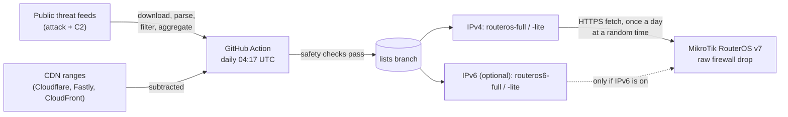

<p align="center">
  
</p>

<p align="center">
  <b>A daily, auto-built IPv4 (and optional IPv6) blocklist of attackers and botnet C2 servers, dropped in the raw firewall of your MikroTik router.</b>
</p>

<p align="center">
  <a href="https://github.com/Psycomy/MikrotikBlockList/actions/workflows/build.yml"></a>
  <a href="https://github.com/Psycomy/MikrotikBlockList/actions/workflows/routeros-e2e.yml"></a>
  <a href="https://github.com/Psycomy/MikrotikBlockList/tree/lists"></a>
  <a href="https://github.com/Psycomy/MikrotikBlockList/tree/lists"></a>
  <a href="LICENSE"></a>
  
</p>

<p align="center">
  <a href="#install">Install</a> ·
  <a href="#what-gets-created">What gets created</a> ·
  <a href="#see-what-is-blocked">Logs</a> ·
  <a href="#allowlist">Allowlist</a> ·
  <a href="#updates">Updates</a> ·
  <a href="#uninstall">Uninstall</a> ·
  <a href="#sources-and-licenses">Sources</a> ·
  <a href="#-español">Español</a>
</p>

> [!WARNING]
> **For home / non-commercial use only — several sources forbid commercial use.**
> Some feeds are CC BY-NC-SA or "non-commercial only", and others have no explicit
> redistribution license (see [Sources and licenses](#sources-and-licenses)).
> If you need a blocklist for a business, get the feeds under a commercial license yourself.

## How it works



Two families (IPv4, optional IPv6) times two variants (`full`, `lite`).

1. Every day a GitHub Action downloads the [sources](#sources-and-licenses), drops private,
   reserved, CGNAT and other non-global ranges (and anything broader than a /8), subtracts the networks in the
   repository [`allowlist.txt`](allowlist.txt) (GitHub's download range and the big public DNS
   resolvers) plus the [automatic CDN allowlist](#automatic-cdn-allowlist), and merges overlapping networks.
2. Safety checks refuse to publish a broken list: between 5,000 and 150,000 entries (`full`; the
   `lite` variant: 1,000 to 20,000), no drop of
   more than 50% and no growth of more than 2x from the previous list, and the required source
   (Spamhaus DROP) must succeed. For an expected jump (e.g. a new source), a maintainer can run
   the workflow by hand (*Actions → build → Run workflow* on `main`) with **allow_growth**
   ticked, which skips only the 2x check (locally: `python -m mbl build --allow-growth`).
   If either variant fails, nothing is published. A drop no larger than the previous entries of
   optional sources that failed this run is accepted with a warning (only the drop check is skipped).
3. The result goes to the orphan [`lists`](https://github.com/Psycomy/MikrotikBlockList/tree/lists)
   branch, overwritten each time with a single commit.
4. Your router fetches `routeros-full.txt` (or `routeros-lite.txt`) over HTTPS (`check-certificate=yes`), reads it as plain
   data, validates every line and adds the addresses to an address list that `/ip firewall raw`
   drops — before connection tracking, so it is cheap. The router never imports or runs anything
   from the file.

## Requirements

- **RouterOS v7.21 or newer** (v6 is not supported). 7.21 is the first release whose built-in
  certificate trust store can be enabled for `fetch` (per the changelog); tested on **CHR 7.24.5**.
- Interface lists named **`WAN`** (your Internet interface) and **`LAN`** (your local interfaces).
  The default home configuration already has them; the installer stops without changing anything
  if they are missing.
- **RAM:** measured on a 256 MiB CHR (RouterOS 7.24.5) with a 40k-entry list: about
  **36.7 MiB free** with one list loaded, and never below **30.5 MiB** while the old and the new
  lists coexist during an update (about 25 seconds). Tight devices should keep an eye on
  `/system resource print`.

## Install

Paste this into the RouterOS terminal (Winbox, WebFig or SSH):

```routeros
/tool fetch url="https://raw.githubusercontent.com/Psycomy/MikrotikBlockList/main/routeros/install.rsc" check-certificate=yes; /import install.rsc
```

It prints `MBL: installed (script 3.3.1, variant full, ipv6 no)` when the first list is loaded (about 20 seconds). The installer is
idempotent: run it again at any time to upgrade or repair; nothing is duplicated and your
allowlist is kept.

### Choose a variant: full or lite

| Variant | Entries (2026-10-21) | Sources | For |
|---|---|---|---|
| `full` (default) | 38,967 | all enabled sources | Routers with enough RAM: attackers, scanners and C2 |
| `lite` | 4,304 | Spamhaus DROP (and DROPv6 with IPv6 on), DShield, Emerging Threats compromised, ThreatFox, ThreatCluster (the `lite` column of [Sources](#sources-and-licenses)) | Little RAM, or you only want C2 and the most serious attack ranges |

To install `lite`, put `:global mblVariant "lite"; ` in front of the one-liner:

```routeros
:global mblVariant "lite"; /tool fetch url="https://raw.githubusercontent.com/Psycomy/MikrotikBlockList/main/routeros/install.rsc" check-certificate=yes; /import install.rsc
```

- The choice is kept when you reinstall: with `mblVariant` empty, the installer reuses the variant
  of the installed `mbl-update`.
- To go back to `full`: `:global mblVariant "full"; ` plus the same one-liner.
- The global lives until the router reboots, so if you reinstall in the same session, set it
  explicitly (`"full"`, `"lite"`, or `""` to keep what is installed).
- Any value other than `full` or `lite` stops the installer before it changes anything.
- The final message tells you which one is installed: `MBL: installed (script 3.3.1, variant lite, ipv6 no)`.
- A downloaded list whose header says another variant is rejected (`bad header`).

### Optional IPv6

IPv6 is **off by default**. To block IPv6 attackers too, put `:global mblIpv6 true; ` in front of
the one-liner (it combines with `:global mblVariant "lite"; `):

```routeros
:global mblIpv6 true; /tool fetch url="https://raw.githubusercontent.com/Psycomy/MikrotikBlockList/main/routeros/install.rsc" check-certificate=yes; /import install.rsc
```

- It adds the IPv6 address lists `mbl6-a`, `mbl6-b` and `mbl6-allow`, the same six `MBL:` rules in
  `/ipv6 firewall raw`, and the boot copy `mbl6-last.txt`. IPv4 is untouched.
- The choice is kept when you reinstall: with `mblIpv6` empty, the installer reuses what the
  installed `mbl-update` has.
- To turn it off: `:global mblIpv6 false; ` plus the same one-liner. This removes every MBL IPv6
  object (rules, `mbl6-*` lists and files); entries you added yourself to `mbl6-allow` are kept.
- Any value other than `true` or `false` stops the installer before it changes anything.
- The global lives until the router reboots, so set it explicitly (`true`, `false`, or `""` to keep
  what is installed) when you reinstall in the same session.
- The final message tells you the state: `MBL: installed (script 3.3.1, variant full, ipv6 yes)`.
- Add your own IPv6 exceptions the same way as for IPv4:
  `/ipv6 firewall address-list add list=mbl6-allow address=2001:db8::/32 comment="my office"`.
- **Best effort:** IPv6 never blocks IPv4. If the IPv6 list fails its checks on the build, no IPv6
  file is published that day (IPv4 still is; `stats.json` has `ipv6.published`). On the router, an
  IPv6 download or validation failure keeps the active IPv6 list, logs `MBL: ipv6 ...`, and never
  touches the IPv4 lists or rules.

IPv6 sources today (2026-10-21), from the [Sources](#sources-and-licenses) table: Spamhaus DROPv6
(91 networks), blocklist.de (about 512), Turris Sentinel (49) and ThreatCluster (1). The real
build gives **637** IPv6 entries in `full` and **86** in `lite` (Spamhaus DROPv6 and ThreatCluster).
The generator drops non-global IPv6 (ULA, link-local, documentation, multicast, IPv4-mapped, NAT64,
6to4, Teredo), anything broader than a /19, and the IPv6 part of [`allowlist.txt`](allowlist.txt)
(GitHub's download range, public DNS resolvers) plus the automatic CDN ranges. Limits: `full` 50 to 20,000 entries,
`lite` 20 to 5,000, with the same 50 % drop and 2x growth checks. On the router a line must be an
IPv6 address or a CIDR with a prefix from 19 to 128, and a file needs at least 200 bytes and 50
(`full`) or 20 (`lite`) entries. The binding rule for a small list is that every listed entry
must load: the count added must equal the header's `entries` exactly. The 1 % invalid-line budget
only tolerates stray lines (comments, blanks, junk) around the entries; on a small `lite` list it
rounds down to no invalid line at all (the generator output is clean).

**Upgrading from v2:** run the same install one-liner again. The old list stays active while the
first v3 list loads, and the old `mbl-*.rsc` boot copies are removed automatically after the first
successful v3 load (log: `MBL: removed v2 files`).

> [!TIP]
> **Certificate error on the one-liner?** On RouterOS 7.21–7.23, or with a customised trust
> store, the built-in CA store may not cover `fetch` yet, so the very first download (before the
> installer can fix it) fails. Check the current value with `/certificate settings print`, then
> run `/certificate settings set builtin-trust-store=fetch` — or add `fetch` to the existing
> value, e.g. `dns,www` becomes `builtin-trust-store=fetch,dns,www` — and paste the one-liner
> again.

> [!NOTE]
> To validate the HTTPS certificate of GitHub, the installer adds the `fetch` component to
> `/certificate settings builtin-trust-store` (RouterOS' built-in CA store), unless it is already
> covered. This is the only setting it touches outside its own `mbl` / `MBL:` objects.

## What gets created

Six rules at the **top** of `/ip firewall raw`, in this order:

| Comment | Chain | Match | Action | Why |
|---|---|---|---|---|
| `MBL: allow-in` | prerouting | src in `mbl-allow` | accept | Your allowlist always wins (inbound) |
| `MBL: allow-out` | prerouting | dst in `mbl-allow` | accept | Your allowlist always wins (outbound) |
| `MBL: in` | prerouting | from `WAN`, src in active list | drop | Blocks scanners and attackers reaching you |
| `MBL: out` | prerouting | from `LAN`, dst in active list | drop + log `MBL-OUT` | Blocks LAN devices talking to C2 / bad hosts, and logs it |
| `MBL: allow-router-out` | output | dst in `mbl-allow` | accept | Allowlist for traffic from the router itself |
| `MBL: router-out` | output | dst in active list | drop | Router's own traffic to listed hosts |

Plus:

| Object | Name | Purpose |
|---|---|---|
| Address lists | `mbl-a`, `mbl-b` | The blocklist; they alternate on each update (entries time out after 7 days) |
| Address list | `mbl-allow` | Your local allowlist; the IPs of the admin sessions open during install are added with comment `MBL: admin` so you cannot lock yourself out |
| Script | `mbl-update` | Downloads, validates and loads the list |
| Scheduler | `mbl-daily` | Runs `mbl-update` once a day at a random time (so routers do not all hit GitHub together) |
| Scheduler | `mbl-boot` | At startup reloads the last good copy at once, then tries a fresh download |
| File | `mbl-last.txt` | Last good list, used at boot (in `flash/` on devices that have it) |

With [IPv6 enabled](#optional-ipv6) it also creates six rules with the same `MBL:` comments in
`/ipv6 firewall raw`, the lists `mbl6-a`, `mbl6-b` (alternating) and `mbl6-allow`, and the file
`mbl6-last.txt`.

## See what is blocked

```routeros
# everything the project logs (updates, errors)
/log print where message~"MBL"

# LAN devices that tried to reach a listed host
/log print where message~"MBL-OUT"

# packet / byte counters of each rule
/ip firewall raw print stats where comment~"MBL"
```

An `MBL-OUT` entry means a device on your network tried to talk to a known C2 or malicious host:
worth checking that device. Only that outbound LAN rule (`MBL: out`) logs; inbound drops
(`MBL: in`) and the router's own blocked traffic (`MBL: router-out`) are not logged, so check
them with the counters above.

If the list on GitHub stops being updated (e.g. the Action is disabled), the router keeps the
last list it loaded and logs `MBL: list is N days old` on each update once it is more than 3
days old.

## Allowlist

Something you need is blocked? Add it to `mbl-allow` (an address or a CIDR):

```routeros
/ip firewall address-list add list=mbl-allow address=203.0.113.10 comment="my office"
```

Entries you add are never removed by updates or reinstalls. The uninstaller removes only
`mbl-allow` entries whose comment is exactly `MBL: admin` (the ones the installer adds), so do not
use that comment for your own entries.

## Updates

When the router logs a warning like `MBL: script 3.3.1 available (installed 3.3.0) - reinstall: ...`,
a newer version of the router script has been published. Run the install command again; it is safe
to repeat and keeps your allowlist. The router never updates itself, and the notice only appears when
the published version is newer. The blocklist itself refreshes daily without any action.

Routers installed before 3.1.0 (v2 and 3.0.0) do not have the check, so they never show this
notice: reinstall once with the install command to get it. Routers on 3.2.0 will see the 3.3.0
notice and can reinstall: they keep their variant and stay IPv4-only unless you enable IPv6
(see [Optional IPv6](#optional-ipv6)).
See the [CHANGELOG](CHANGELOG.md) for what changed.

## Automatic CDN allowlist

Big CDN ranges are never blocked, so a noisy feed cannot take half the web with it. On every build
the generator downloads the published ranges of **Cloudflare**, **Fastly** and **CloudFront** and
subtracts them (IPv4 and IPv6), on top of the static [`allowlist.txt`](allowlist.txt) (GitHub and
public DNS only).

- A download is rejected if it cannot be read, has fewer than 5 IPv4 prefixes, or contains an IPv4
  prefix broader than /8 or an IPv6 prefix broader than /16 (so `0.0.0.0/0` never empties the list).
- A rejected provider falls back to its block in
  [`allowlist-cdn.snapshot.txt`](allowlist-cdn.snapshot.txt); if it is not there either, the build
  goes on without it and warns on stderr and in the step summary.
- Safety cap, measured two ways against the list before the allowlist: the addresses it removes
  and the entries it touches (an entry that overlaps any allowlist range, wholly or partly). If
  either is over 10 % of the IPv4 `full` list, the build fails; for IPv6 the IPv6 files are
  withheld instead. The error gives both numbers. There is no override flag. Usually a feed has
  started listing CDN or cloud ranges wholesale: remove or narrow that source in `sources.toml`
  and re-run (see [`docs/security.md`](docs/security.md#when-the-allowlist-cap-stops-the-build)).
  Adding more ranges to [`allowlist.txt`](allowlist.txt) never gets a build under the cap: it is
  counted in the same measures.
- `stats.json` reports it under `cdn_allowlist` (per provider: `source` = `live`, `snapshot` or
  `missing`, plus `prefixes4` and `prefixes6`) and `cdn_allowlist.cap` (`limit_pct`, and per family
  `ipv4` / `ipv6`: `addresses`, `addresses_removed`, `addresses_pct`, `entries`, `entries_touched`,
  `entries_pct`).
- A snapshot block older than 90 days (date in its `# provider <name> <date>` header) is still
  used, with a louder warning asking for a refresh.
- The snapshot is refreshed by hand, through a pull request:
  `python -m mbl cdn-snapshot --out allowlist-cdn.snapshot.txt`. The workflow never commits to `main`.

## Uninstall

```routeros
/tool fetch url="https://raw.githubusercontent.com/Psycomy/MikrotikBlockList/main/routeros/uninstall.rsc" check-certificate=yes; /import uninstall.rsc
```

It removes only what the installer created (`mbl-*` names, `MBL:` comments, `mbl-*.rsc` / `mbl-*.txt` files and
the `MBL: admin` allowlist entries), for both families: with IPv6 it also removes the six `MBL:`
rules in `/ipv6 firewall raw`, the `mbl6-a` / `mbl6-b` lists, the `MBL: admin` entries of
`mbl6-allow` and the `mbl6-*.txt` files. Your own `mbl-allow` / `mbl6-allow` entries are kept. The `fetch` component
added to `builtin-trust-store` is **not** reverted; set it back by hand if you want.

## Sources and licenses

Defined in [`sources.toml`](sources.toml). **C2** = botnet command-and-control servers;
**attack** = scanners, brute-forcers, spammers and other abusive hosts.

| Source | Category | lite | License / terms (as stated by the source) |
|---|---|:---:|---|
| [Spamhaus DROP](https://www.spamhaus.org/drop/) *(required)* | attack | yes | Free under the Spamhaus DROP terms; **no explicit redistribution grant** — home use |
| [Spamhaus DROPv6](https://www.spamhaus.org/drop/) (IPv6, used only with IPv6 on) | attack | yes | Free under the Spamhaus DROP terms; **no explicit redistribution grant** — home use |
| [Emerging Threats compromised IPs](https://rules.emergingthreats.net/blockrules/) | attack | yes | Emerging Threats open rules, BSD-style terms |
| [CINS Army](https://cinsscore.com/) | attack |  | Usable "in any way you see fit"; no formal license |
| [blocklist.de](https://www.blocklist.de/) | attack |  | **Unknown** — check the source terms |
| [DShield](https://www.dshield.org/) | attack | yes | CC BY-NC-SA (non-commercial only, attribution) |
| [IPsum level 3](https://github.com/stamparm/ipsum) | attack |  | The Unlicense (public domain) |
| [Binary Defense banlist](https://www.binarydefense.com/) | attack |  | Public use only, no commercial use (file header) |
| [Turris Sentinel greylist](https://view.sentinel.turris.cz/greylist-data/) (CZ.NIC, honeypots on Turris routers) | attack |  | CC BY-NC-SA 4.0 (non-commercial only, attribution) |
| [abuse.ch ThreatFox](https://threatfox.abuse.ch/) | c2 | yes | abuse.ch fair use, free; commercial use may need the paid API |
| [ThreatCluster](https://threatcluster.io/iocs) | c2 | yes | **No license stated** — check the source terms |
| [Data-Shield IPv4](https://github.com/duggytuxy/Data-Shield_IPv4_Blocklist) *(optional, disabled)* | attack |  | Repository GPLv3 |
| [AbuseIPDB s100 (borestad)](https://github.com/borestad/blocklist-abuseipdb) *(optional, disabled)* | attack |  | No license stated; AbuseIPDB data used with permission |

The selection comes from a comparison of 44 free feeds (size, overlap, unique contribution,
false positives against CDN ranges and the top 5,000 sites, freshness and license): see
[`docs/source-study-2026-10-20.md`](docs/source-study-2026-10-20.md).

**Removed:** GreenSnow (forbids republication); Feodo Tracker (not updated since March 2026);
C2IntelFeeds (fully contained in ThreatFox); BruteForceBlocker (≈ Emerging Threats compromised);
Emerging Threats block IPs (= Spamhaus DROP + DShield); StopForumSpam (forum-spam ranges).
Dataplane.org was not added because it forbids redistribution.

The license notes above are a best-effort summary, not legal advice. All credit for the data
goes to the projects listed.

## Published files

The [`lists`](https://github.com/Psycomy/MikrotikBlockList/tree/lists) branch contains:

| File | Content |
|---|---|
| `routeros-full.txt` | List in the router format (header line, one address per line, footer line); this is what v3 routers on `full` download |
| `routeros-lite.txt` | Same format, `lite` variant (5 sources, about 4,300 entries); what v3 routers on `lite` download |
| `blocklist.rsc` | **Legacy** and `full` only (there is no `lite` version); only for routers still on v2; published unchanged and kept at least until 2027-04-30. v3 routers do not use it |
| `blocklist.txt` | Plain list (`full`), one IPv4 address or CIDR per line, no header — **handy for other firewalls** (pfSense, OPNsense, iptables/ipset, nftables…) |
| `blocklist-lite.txt` | The same plain list for the `lite` variant |
| `routeros6-full.txt`, `routeros6-lite.txt` | IPv6 lists in the router format (`family=ipv6` in the header); only IPv6 routers download them. Not published on a day when IPv6 fails its checks |
| `blocklist6.txt`, `blocklist6-lite.txt` | Plain IPv6 lists (`full` / `lite`), one address or CIDR per line (`/128` without mask), for other firewalls |
| `stats.json` | Generation time, total (`full`), `variants` (total of `full` and `lite`), `ipv6` (`published` and totals per variant), `cdn_allowlist` (per provider: `source`, `prefixes4`, `prefixes6`), and per-source IPv4 `entries`, IPv6 `entries6` and errors |
| [`NOTICE.md`](https://github.com/Psycomy/MikrotikBlockList/blob/lists/NOTICE.md) | Attribution: every source used in that build, its URL, terms and entry count |
| `badge-entries.json`, `badge-updated.json` | shields.io endpoints for the badges above |

<details>
<summary><b>How an update works on the router</b></summary>

1. `mbl-update` downloads `routeros-<variant>.txt` (`full` or `lite`, as installed) over HTTPS with `check-certificate=yes`. A failed
   download changes nothing.
2. It checks the size (at least 100,000 bytes for `full`, 20,000 for `lite`) and reads the file with `/file read` in 32 KiB
   chunks. The first line must be the header (`# MikrotikBlockList v3 format=1 variant=<variant>
   family=ipv4 ... entries=N script=<version>`), so an HTML error page is never accepted.
3. Every other line is only a value: it must be an IPv4 address or a CIDR with a prefix from 8 to
   32, and only then is it added to the list the rules are **not** using (`mbl-a` or `mbl-b`).
   Nothing from the file is imported, parsed or executed; a line such as `/system reboot` is just an
   invalid line.
4. The load is rejected, and the active list kept, if the header is missing or wrong (including a `variant=` other than the installed one), the footer
   (`# MBL-END entries=N`) is missing, the header and footer counts differ, the added count differs
   from `entries`, more than 1 % of the lines are invalid, or fewer than 1,000 entries were added.
   The log line `MBL: <file> rejected (<reason>), active list kept` names the reason: `no header`,
   `bad header`, `no footer`, `header/footer mismatch`, `count mismatch`, `too many invalid lines
   (N)`, `too few entries (N)` or `read error`.
5. Only then are the three drop rules switched to the new list, and the old one is emptied. You are
   protected the whole time; the two lists coexist only while the update runs.
6. The new file is kept as `mbl-last.txt`. On devices with a `flash/` directory the download and
   read use RAM, and only the validated file is copied to `flash/mbl-last.txt`, if free storage
   is more than twice its size (otherwise a warning is logged and the previous copy is kept).
   Address-list entries with a timeout do not survive a
   reboot, so `mbl-boot` reloads this copy at startup (in seconds, even without Internet) and
   then tries a fresh download 60 seconds later.
7. A lock prevents two updates from running at once; everything is logged with the `MBL:` prefix.
8. With IPv6 enabled, once the IPv4 update is done the same reader processes `routeros6-<variant>.txt`
   into `mbl6-a` / `mbl6-b` (header `family=ipv6`, lines validated as IPv6 with a prefix from 19 to
   128). Log: `MBL: loaded <n> ipv6 entries into <list> (list generated <stamp>)` or
   `MBL: <file> rejected (<reason>), active ipv6 list kept`. A failure here never changes the IPv4 result.

Measured on a CHR 7.24.5 with 1 vCPU and 256 MiB (2026-10-21): a full update of 40,000 entries
takes about 25 s; free RAM is 36.7 MiB with one list loaded and at least 30.5 MiB while both lists
coexist. Full test record: [docs/testing-chr.md](docs/testing-chr.md) (in Spanish).

</details>

<details>
<summary><b>FAQ</b></summary>

**Does it support IPv6?** Yes, optionally and off by default: see [Optional IPv6](#optional-ipv6).

**Does it support RouterOS v6?** No. v7.21 or newer.

**Will it lock me out?** The IPs of your management sessions during install are added to
`mbl-allow`, and the allow rules come first. If you manage the router from a different address
later, add it to `mbl-allow` too.

**Something legitimate is blocked.** Add it to `mbl-allow` (see [Allowlist](#allowlist)). If it is
a false positive in a feed, report it to that feed.

**How do I force an update now?** `/system script run mbl-update`, then check `/log print where message~"MBL"`.

**My device has little RAM.** On a 256 MiB CHR with a 40k-entry list, free RAM was about 36.7 MiB
with one list and never below 30.5 MiB during an update (two lists for about 25 seconds). Check free memory with `/system resource print` before installing.

**Why the raw table and not the filter table?** Raw rules run before connection tracking, so
dropped packets cost almost nothing and never create conntrack entries.

</details>

<details>
<summary><b>Forks</b></summary>

1. Fork the repository. The workflow uses `${{ github.repository }}`, so it publishes to **your**
   `lists` branch automatically (enable Actions in your fork; it runs daily and on pushes to `main`).
2. Edit [`sources.toml`](sources.toml) and [`allowlist.txt`](allowlist.txt) as you like.
3. In [`routeros/install.rsc`](routeros/install.rsc) change the `mblBase` line at the top to your
   fork's `.../lists` URL (the script appends `/routeros-<variant>.txt`), and use your fork's URL in the install one-liner.
   To test against another server, set `:global mblUrlBase "https://host:port"` before the `/import`.

Build locally (Python 3.12, no dependencies):

```bash
python -m unittest discover -v
python -m mbl build --sources sources.toml --allowlist allowlist.txt --out dist
```

The RouterOS installer is also tested end to end on a disposable CHR (`MBL_E2E=1 python -m unittest tests.e2e.test_routeros -v`, needs QEMU/KVM; runs in CI as `routeros-e2e`). See [docs/testing-chr.md](docs/testing-chr.md).

</details>

## Security and reporting problems

- [`docs/security.md`](docs/security.md): threat model, what to configure on GitHub, and how to report a vulnerability privately.
- Wrongly blocked address or a bug? Use the issue forms:
  [false positive](https://github.com/Psycomy/MikrotikBlockList/issues/new?template=false_positive.yml) or
  [bug report](https://github.com/Psycomy/MikrotikBlockList/issues/new?template=bug.yml).
- Reinstalling is safe and has no gap: the old `MBL:` rules are renamed `MBL-OLD:` and removed
  only after the new ones exist.
- A reinstall never races an update: the installer stops with `MBL: an update is running
  (mblRunning is set)` and changes nothing while `mbl-update` runs (try again in a minute), and
  holds the same lock from its first change until its own first load is done, so a daily update
  started meanwhile is skipped.
  If the lock is stuck (an interrupted run), clear it with `:global mblRunning false`. As a second
  guard, `mbl-update` skips a family whose `MBL: in` rule is missing, and drops its load (keeping
  the active list) if that rule changed while it was loading.

## License

[GPL-3.0](LICENSE) covers **the code only** (generator, workflow and RouterOS scripts).
The blocklist data is compiled from third-party sources and remains under each source's own
terms, not under the GPL-3.0. Per-build attribution: [`NOTICE.md`](https://github.com/Psycomy/MikrotikBlockList/blob/lists/NOTICE.md) on the `lists` branch
(see also [Sources and licenses](#sources-and-licenses)).

---

## 🇪🇸 Español

**MikrotikBlockList** genera cada día una lista IPv4 (e IPv6, opcional) de atacantes y servidores C2 de botnets a
partir de fuentes públicas, y la bloquea en el firewall *raw* de tu router MikroTik (RouterOS v7).

> [!WARNING]
> **Solo para uso doméstico / no comercial: varias fuentes prohíben el uso comercial.**
> Algunas son CC BY-NC-SA o "solo no comercial", y otras no tienen una licencia de
> redistribución explícita (ver la [tabla de fuentes](#sources-and-licenses)).

**Fuentes:** 10 listas elegidas tras comparar 44 fuentes gratuitas por tamaño, solapamiento,
aportación única, falsos positivos (CDN y los 5.000 sitios más visitados), frescura y licencia:
ver [`docs/source-study-2026-10-20.md`](docs/source-study-2026-10-20.md). La allowlist del
repositorio excluye siempre el rango de descarga de GitHub y los DNS públicos, y el build resta además los rangos de
Cloudflare, Fastly y CloudFront de forma automática (ver [Allowlist automática de CDN](#allowlist-automática-de-cdn)).

**Requisitos:** RouterOS **7.21 o superior** (probado en CHR 7.24.5), listas de interfaces **`WAN`**
y **`LAN`**, y algo de RAM libre: medido en un CHR de 256 MiB con una lista de 40k entradas, unos 36,7 MiB
libres con una lista y nunca menos de 30,5 MiB durante una actualización (dos listas unos 25 segundos).

### Instalación

```routeros
/tool fetch url="https://raw.githubusercontent.com/Psycomy/MikrotikBlockList/main/routeros/install.rsc" check-certificate=yes; /import install.rsc
```

Crea seis reglas `MBL:` arriba del todo en `/ip firewall raw`, las listas alternas `mbl-a` / `mbl-b`,
la allowlist `mbl-allow` (con las IPs de administración actuales como `MBL: admin`), el script
`mbl-update` y los schedulers `mbl-daily` (una vez al día, a hora aleatoria) y `mbl-boot` (recarga
`mbl-last.txt` al arrancar). Además activa el componente `fetch` en el almacén de certificados
integrado (`builtin-trust-store`). Se puede volver a ejecutar sin duplicar nada.

**Cómo funciona en el router:** descarga `routeros-<variante>.txt`, lo lee con `/file read` en trozos
de 32 KiB y valida cada línea (IPv4 o CIDR con prefijo de 8 a 32); solo añade direcciones. Nunca
importa ni ejecuta el contenido del fichero. Si falta la cabecera o el pie, no coinciden los
conteos, hay más de un 1 % de líneas inválidas o quedan menos de 1000 entradas, se rechaza la
carga y se conserva la lista activa. El log indica el motivo en `MBL: <fichero> rejected (<motivo>),
active list kept`: `no header`, `bad header`, `no footer`, `header/footer mismatch`,
`count mismatch`, `too many invalid lines (N)`, `too few entries (N)` o `read error`. Medido en un CHR 7.24.5 (1 vCPU, 256 MiB): 40.000 entradas
en unos 25 s.

**Elegir variante (*full* o *lite*):** `full` es la de por defecto (38.967 entradas IPv4 el 2026-10-21).
`lite` (4.304 entradas IPv4) usa solo Spamhaus DROP (y DROPv6 con IPv6 activado), DShield, Emerging Threats compromised, ThreatFox y
ThreatCluster (columna `lite` de la [tabla de fuentes](#sources-and-licenses)); es para routers con
poca RAM o si solo quieres bloquear C2 y los rangos de ataque más graves. Para instalar `lite`, pon
`:global mblVariant "lite"; ` delante del comando de instalación:

```routeros
:global mblVariant "lite"; /tool fetch url="https://raw.githubusercontent.com/Psycomy/MikrotikBlockList/main/routeros/install.rsc" check-certificate=yes; /import install.rsc
```

- La elección se conserva al reinstalar: con `mblVariant` vacía, el instalador usa la variante del
  `mbl-update` instalado.
- Para volver a `full`: `:global mblVariant "full"; ` y el mismo comando.
- La global dura hasta que el router se reinicia; si reinstalas en la misma sesión, defínela de forma
  explícita (`"full"`, `"lite"` o `""` para conservar lo instalado).
- Cualquier valor distinto de `full` o `lite` detiene el instalador antes de cambiar nada.
- El mensaje final indica la variante: `MBL: installed (script 3.3.1, variant lite, ipv6 no)`.
- Una lista descargada con otra `variant=` en la cabecera se rechaza (`bad header`).
- Límites de publicación: `full` 5.000 a 150.000 entradas, `lite` 1.000 a 20.000; si falla cualquiera
  de las dos, no se publica nada. Tamaño mínimo del fichero en el router: 100.000 bytes (`full`) y
  20.000 (`lite`).
- Una caída no mayor que las entradas anteriores de las fuentes opcionales que fallan en esa
  ejecución se acepta con un aviso (solo se omite la comprobación de caída).

**Ficheros publicados:** `routeros-full.txt` y `routeros-lite.txt` (formato del router, con cabecera
y pie), `blocklist.rsc` (**legado** para routers con v2, solo `full`, se mantiene al menos hasta
2027-04-30), y `blocklist.txt` y `blocklist-lite.txt` (una entrada por línea, sin cabecera, para otros
firewalls). `stats.json` añade `variants` con el total de cada variante y `cdn_allowlist`.

### IPv6 opcional

Viene **desactivado**. Para bloquear también atacantes IPv6, pon
`:global mblIpv6 true; ` delante del comando de instalación (se combina con `:global mblVariant "lite"; `):

```routeros
:global mblIpv6 true; /tool fetch url="https://raw.githubusercontent.com/Psycomy/MikrotikBlockList/main/routeros/install.rsc" check-certificate=yes; /import install.rsc
```

- Añade las listas IPv6 `mbl6-a`, `mbl6-b` y `mbl6-allow`, las mismas seis reglas `MBL:` en
  `/ipv6 firewall raw` y la copia de arranque `mbl6-last.txt`. IPv4 no cambia.
- La elección se conserva al reinstalar: con `mblIpv6` vacía, el instalador usa lo que tiene el
  `mbl-update` instalado.
- Para desactivarlo: `:global mblIpv6 false; ` y el mismo comando. Borra todos los objetos IPv6 de
  MBL (reglas, listas y ficheros `mbl6-*`); las entradas que hayas añadido tú a `mbl6-allow` se conservan.
- Cualquier valor distinto de `true` o `false` detiene el instalador antes de cambiar nada.
- La global dura hasta que el router se reinicia; si reinstalas en la misma sesión, defínela de forma
  explícita (`true`, `false` o `""` para conservar lo instalado).
- El mensaje final indica el estado: `MBL: installed (script 3.3.1, variant full, ipv6 yes)`.
- Tus excepciones IPv6 van igual que las de IPv4:
  `/ipv6 firewall address-list add list=mbl6-allow address=2001:db8::/32 comment="mi oficina"`.
- **Mejor esfuerzo:** IPv6 nunca bloquea IPv4. Si la lista IPv6 no pasa las comprobaciones en la
  generación, ese día no se publica ningún fichero IPv6 (IPv4 sí; `stats.json` tiene `ipv6.published`).
  En el router, un fallo de descarga o validación de IPv6 conserva la lista IPv6 activa, registra
  `MBL: ipv6 ...` y no toca nunca las listas ni las reglas IPv4.
- Fuentes IPv6 hoy (2026-10-21): Spamhaus DROPv6 (91 redes), blocklist.de (unas 512), Turris Sentinel (49)
  y ThreatCluster (1). El build real da **637** entradas IPv6 en `full` y **86** en `lite` (Spamhaus
  DROPv6 y ThreatCluster).
- El generador descarta IPv6 no global (ULA, link-local, documentación, multicast, IPv4-mapped,
  NAT64, 6to4, Teredo), todo lo más amplio que /19 y la parte IPv6 de `allowlist.txt` (el rango de
  descarga de GitHub y los DNS públicos) más los rangos CDN automáticos. Límites: `full` 50 a 20.000 entradas, `lite`
  20 a 5.000, con las mismas comprobaciones de caída del 50 % y crecimiento de 2x.
- En el router, cada línea debe ser una dirección IPv6 o un CIDR con prefijo de 19 a 128; el fichero
  necesita al menos 200 bytes y 50 (`full`) o 20 (`lite`) entradas. En una lista pequeña la regla
  que manda es que cada entrada listada debe cargarse: lo añadido tiene que coincidir exactamente con
  `entries` de la cabecera. El 1 % de líneas inválidas solo tolera líneas sueltas (comentarios,
  vacías, basura) alrededor de las entradas; en una lista `lite` pequeña se queda en ninguna (la
  salida del generador está limpia).
- Ficheros: `routeros6-full.txt` y `routeros6-lite.txt` (formato del router, `family=ipv6`), y
  `blocklist6.txt` y `blocklist6-lite.txt` (una entrada por línea, para otros firewalls). `stats.json`
  añade `ipv6` y `entries6` por fuente; `entries` pasa a contar solo IPv4.

**Actualizar desde la v2:** vuelve a ejecutar el mismo comando de instalación. La lista antigua
sigue activa mientras carga la primera lista v3, y los `mbl-*.rsc` antiguos se borran solos tras la
primera carga v3 correcta (log `MBL: removed v2 files`).

> [!TIP]
> **¿Error de certificado en el comando?** En RouterOS 7.21–7.23, o con un almacén de confianza
> personalizado, puede que el almacén integrado aún no cubra `fetch` y falle la primera descarga
> (antes de que el instalador lo arregle). Mira el valor con `/certificate settings print` y
> ejecuta `/certificate settings set builtin-trust-store=fetch`, o añade `fetch` al valor actual
> (p. ej. `dns,www` pasa a `builtin-trust-store=fetch,dns,www`); después repite el comando.

### Allowlist

```routeros
/ip firewall address-list add list=mbl-allow address=203.0.113.10 comment="mi oficina"
```

Las actualizaciones y reinstalaciones nunca borran tus entradas. El desinstalador solo borra las
entradas de `mbl-allow` con el comentario exacto `MBL: admin` (las que añade el instalador): no
uses ese comentario en las tuyas.

### Allowlist automática de CDN

En cada build se descargan los rangos publicados de **Cloudflare**, **Fastly** y **CloudFront** y se
restan (IPv4 e IPv6), además de `allowlist.txt` (ahora solo GitHub y DNS públicos). Una descarga se
rechaza si no se puede leer, trae menos de 5 prefijos IPv4 o contiene un prefijo IPv4 más amplio que
/8 o IPv6 más amplio que /16; entonces se usa su bloque de
[`allowlist-cdn.snapshot.txt`](allowlist-cdn.snapshot.txt) (o se sigue sin ese proveedor, con aviso).
Tope, medido de dos formas sobre la lista sin allowlist: las direcciones que elimina y las entradas
que toca (las que se solapan, entera o parcialmente, con algún rango de la allowlist). Si cualquiera
de las dos pasa del 10 % de la lista IPv4 *full*, el build falla; en IPv6 se retiene IPv6. El error
da las dos cifras. No hay opción para saltárselo: lo normal es que una fuente haya empezado a listar
rangos de CDN o de nube enteros; quita o acota esa fuente en `sources.toml` y vuelve a lanzar el build
(añadir rangos a `allowlist.txt` no sirve: cuentan en las mismas medidas). `stats.json` lo refleja en
`cdn_allowlist` (`live`, `snapshot` o `missing`) y en `cdn_allowlist.cap` (porcentajes de direcciones
y de entradas por familia). Un bloque de la copia con más de 90 días (fecha de su cabecera) se sigue
usando, con un aviso para renovarlo. La copia se actualiza a mano con
`python -m mbl cdn-snapshot --out allowlist-cdn.snapshot.txt`, mediante PR.

### Seguridad y reportes

Modelo de amenaza, ajustes recomendados de GitHub e informe privado de vulnerabilidades:
[`docs/security.md`](docs/security.md). Para un falso positivo o un fallo usa las plantillas:
[falso positivo](https://github.com/Psycomy/MikrotikBlockList/issues/new?template=false_positive.yml) y
[bug](https://github.com/Psycomy/MikrotikBlockList/issues/new?template=bug.yml). Reinstalar no deja
huecos: las reglas `MBL:` viejas pasan a `MBL-OLD:` y se borran cuando ya existen las nuevas. Tampoco
choca con una actualización: mientras `mbl-update` corre, el instalador se detiene sin cambiar nada
(`MBL: an update is running (mblRunning is set)`; reinténtalo en un minuto) y, desde su primer
cambio hasta terminar su primera carga, tiene el mismo cerrojo, así que una actualización diaria que
arranque entonces se omite. Si el cerrojo se queda puesto (una ejecución interrumpida), libéralo con `:global mblRunning false`. Además,
`mbl-update` omite una familia sin su regla `MBL: in` y descarta la carga (conserva la lista activa) si
esa regla cambió mientras cargaba.

### Ver bloqueos

```routeros
/log print where message~"MBL"
/log print where message~"MBL-OUT"
/ip firewall raw print stats where comment~"MBL"
```

`MBL-OUT` indica que un equipo de tu LAN intentó conectar con un host de la lista: conviene revisarlo.
Solo registra esa regla de salida de la LAN (`MBL: out`); lo bloqueado de entrada (`MBL: in`) y el
tráfico propio del router (`MBL: router-out`) no se registran: míralos en los contadores.

Si la lista de GitHub deja de actualizarse (p. ej. la Action está desactivada), el router mantiene
la última lista cargada y, cuando tiene más de 3 días, registra `MBL: list is N days old` en cada
actualización.

Para los mantenedores: el workflow rechaza publicar si el total crece más del doble. Ante un salto
esperado (p. ej. una fuente nueva), ejecútalo a mano (*Actions → build → Run workflow* en `main`)
marcando **allow_growth**, que solo omite esa comprobación (en local: `python -m mbl build --allow-growth`).

Para probar contra otro servidor, define `:global mblUrlBase "https://host:port"` antes del `/import` del instalador.

### Actualizaciones

Si el router registra un aviso como `MBL: script 3.3.1 available (installed 3.3.0) - reinstall: ...`,
hay publicada una versión más nueva del script. Basta con volver a ejecutar el comando de instalación;
se puede repetir sin riesgo y conserva tu allowlist. El router nunca se actualiza solo y el aviso solo
sale si la versión publicada es mayor. La lista se renueva cada día sin hacer nada. Los cambios están
en el [CHANGELOG](CHANGELOG.md).

Los routers instalados antes de la 3.1.0 (v2 y 3.0.0) no incluyen esta comprobación y nunca muestran
el aviso: reinstala una vez con el comando de instalación para activarla. Los routers con la 3.2.0
verán el aviso de la 3.3.0 y pueden reinstalar: conservan su variante y siguen solo con IPv4 salvo que
actives IPv6 (ver [IPv6 opcional](#ipv6-opcional)).

### Desinstalación

```routeros
/tool fetch url="https://raw.githubusercontent.com/Psycomy/MikrotikBlockList/main/routeros/uninstall.rsc" check-certificate=yes; /import uninstall.rsc
```

Borra solo lo que creó el instalador, de las dos familias: con IPv6 también quita las seis reglas
`MBL:` de `/ipv6 firewall raw`, las listas `mbl6-a` / `mbl6-b`, las entradas `MBL: admin` de
`mbl6-allow` y los ficheros `mbl6-*.txt`. Conserva tus entradas de `mbl-allow` / `mbl6-allow` (salvo
las que tengan el comentario exacto `MBL: admin`). No revierte el
componente `fetch` de `builtin-trust-store`.

Registro de pruebas: [docs/testing-chr.md](docs/testing-chr.md). El instalador también se prueba de extremo a extremo en un CHR desechable (workflow `routeros-e2e`).

**Licencia:** [GPL-3.0](LICENSE) cubre **solo el código** (generador, workflow y scripts de
RouterOS). Los datos de la lista proceden de fuentes de terceros y siguen bajo los términos de
cada fuente, no bajo la GPL-3.0. Atribución de cada build: [`NOTICE.md`](https://github.com/Psycomy/MikrotikBlockList/blob/lists/NOTICE.md) en la rama `lists`.
